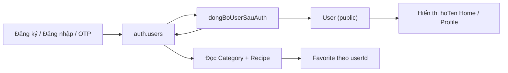

# Mô hình dữ liệu — CookBook (`nhom2_flutter_app`)

Tài liệu mô tả **đầy đủ** cấu trúc database Supabase, quan hệ bảng, RLS, luồng auth/profile và ánh xạ model Dart.

**Nguồn tham chiếu:** `supabase_schema.sql`, `lib/model/`, `lib/helper/auth_helper.dart`, `lib/helper/supabase_helper.dart`, `lib/controller/`.

**Cập nhật:** bảng `"User"` (profile `hoTen`), cột camelCase, UI app đã nối Supabase.

---

## 1. Tổng quan

| Thành phần | Mô tả |
|------------|--------|
| **Backend** | Supabase — PostgreSQL (`public`) + Auth (`auth.users`) |
| **Xác thực** | Email + mật khẩu; đăng ký có thể cần **OTP 6 số** (Confirm sign up, template `{{ .Token }}`) |
| **Profile** | Bảng `"User"` trong `public` (1–1 với `auth.users.id`) + metadata Auth (`hoTen`, `full_name`) |
| **Nghiệp vụ** | `"Category"`, `"Recipe"`, `"Favorite"` |
| **Flutter** | Model + `*Snapshot` (`fromMap` / `toMap`), helper generic, `auth_helper.dart` |

### Luồng dữ liệu chính



1. User đăng ký/đăng nhập/xác thực OTP → session trên `auth.users`.
2. `dongBoUserSauAuth()` **upsert** bản ghi `"User"` (`id`, `email`, `hoTen`) và cập nhật metadata Auth nếu có tên.
3. App đọc danh mục & công thức (`Category`, `Recipe`) — RLS `select` mở.
4. User bật/tắt yêu thích → `"Favorite"` — RLS chỉ bản ghi `userId = auth.uid()`.
5. Hiển thị tên: `UserSnapshot.getCurrentUserProfile()` — ưu tiên `hoTen` từ DB, fallback metadata Auth.

### Quy ước tên

| Lớp | Quy ước |
|-----|---------|
| Bảng SQL | PascalCase có ngoặc kép: `"Category"`, `"Recipe"`, `"Favorite"`, `"User"` |
| Cột SQL / Dart | camelCase: `moTa`, `hinhAnh`, `userId`, `idCategory`, `hoTen` |
| Schema Auth | `auth.users` (snake_case hệ thống Supabase) |

File SQL duy nhất trong repo: **`supabase_schema.sql`**.

---

## 2. Danh sách bảng

| # | Bảng | Schema | Trong `supabase_schema.sql` | Model Dart | Ghi chú |
|---|------|--------|----------------------------|------------|---------|
| 1 | `users` | `auth` | Hệ thống Supabase | — (dùng `supabase.auth`) | Tài khoản, mật khẩu, session |
| 2 | `User` | `public` | Có | `User` + `UserSnapshot` | Profile: email, họ tên |
| 3 | `Category` | `public` | Có | `Category` + `CategorySnapshot` | Danh mục món |
| 4 | `Recipe` | `public` | Có | `Recipe` + `RecipeSnapshot` | Công thức |
| 5 | `Favorite` | `public` | Có | `Favorite` + `FavoriteSnapshot` | Yêu thích N–M User–Recipe |

**Tổng:** 1 bảng Auth + **4 bảng `public`** (logic 5 nguồn dữ liệu cho app).

---

## 3. Thuộc tính từng bảng

### 3.1. `auth.users` (Supabase Auth)

Không tạo trong `supabase_schema.sql`. App chỉ gọi API Auth.

| Trường (tiêu biểu) | Kiểu | PK | Mô tả |
|--------------------|------|----|--------|
| `id` | `uuid` | ✓ | Khóa chính — trùng `"User".id` |
| `email` | `text` | | Email đăng nhập |
| `encrypted_password` | — | | Do Supabase quản lý |
| `email_confirmed_at` | `timestamptz` | | Sau OTP / xác nhận email |
| `raw_user_meta_data` / `user_metadata` | `jsonb` | | App ghi `hoTen`, `full_name` khi đăng ký |

**Metadata app sử dụng** (`layHoTenTuAuthMetadata` — thứ tự ưu tiên):

1. `hoTen`
2. `full_name` (Display Name Supabase)
3. `name`

**Không** map trực tiếp sang bảng `public` bằng `fromMap` — đọc qua `User.fromAuthUser()` hoặc sau khi đồng bộ sang `"User"`.

---

### 3.2. Bảng `"User"` (profile)

| Cột DB | Kiểu SQL | PK | FK | Nullable | Model Dart | Mô tả |
|--------|----------|----|----|----------|------------|--------|
| `id` | `uuid` | ✓ | → `auth.users(id)` ON DELETE CASCADE | NOT NULL | `id` | Cùng id Auth |
| `email` | `text` | | | Có | `email` | Copy từ Auth khi đồng bộ |
| `hoTen` | `text` | | | Có | `hoTen` | Họ tên hiển thị |

**Thao tác app:**

| Hàm | File | Mô tả |
|-----|------|--------|
| `UserSnapshot.getById` | `user.dart` | `select` theo `id` |
| `UserSnapshot.luuProfile` | `user.dart` | `upsert` toàn bộ `toMap()` |
| `UserSnapshot.getCurrentUserProfile` | `user.dart` | DB có `hoTen` → dùng DB; không → `fromAuthUser` |
| `dongBoUserSauAuth` | `auth_helper.dart` | Sau sign-in / sign-up / verify OTP |

**Gọi đồng bộ:** `signInAuth`, `signUpAuth` (nếu có session), `verifyEmailOtpAuth`.

---

### 3.3. Bảng `"Category"`

| Cột DB | Kiểu SQL | PK | FK | Nullable | Model Dart |
|--------|----------|----|----|----------|------------|
| `id` | `bigint` identity | ✓ | | NOT NULL | `id` |
| `ten` | `text` | | | NOT NULL | `ten` |
| `moTa` | `text` | | | Có | `moTa` |

**Dữ liệu mẫu (seed):** Mon chinh, Mon phu, Trang mieng.

---

### 3.4. Bảng `"Recipe"`

| Cột DB | Kiểu SQL | PK | FK | Nullable / Default | Model Dart |
|--------|----------|----|----|---------------------|------------|
| `id` | `bigint` identity | ✓ | | NOT NULL | `id` |
| `ten` | `text` | | | NOT NULL | `ten` |
| `moTa` | `text` | | | default `''` | `moTa` |
| `hinhAnh` | `text` | | | default `''` | `hinhAnh` (URL ảnh) |
| `thoiGian` | `int` | | | default `0` | `thoiGian` (phút) |
| `doKho` | `int` | | | default `2`, check 1–3 | `doKho` (`int` Dart): 1 Dễ, 2 Trung bình, 3 Khó |
| `idCategory` | `bigint` | | → `"Category"(id)` | Có (null được) | `idCategory` |
| `nguyenLieu` | `text` | | | default `''` | `nguyenLieu` (chuỗi, tách dòng bằng `,` `;` `\n`) |
| `cachLam` | `text` | | | default `''` | `cachLam` |

**Dữ liệu mẫu:** Pho bo, Com tam, Banh flan (FK `idCategory` 1, 1, 3).

**Lưu ý:** `nguyenLieu` / `cachLam` lưu **một cột text**, không chuẩn hóa bảng con.

---

### 3.5. Bảng `"Favorite"`

| Cột DB | Kiểu SQL | PK | FK | Ràng buộc | Model Dart |
|--------|----------|----|----|-----------|------------|
| `id` | `bigint` identity | ✓ | | | `id` |
| `userId` | `uuid` | | → `auth.users(id)` CASCADE | NOT NULL | `userId` |
| `recipeId` | `bigint` | | → `"Recipe"(id)` CASCADE | NOT NULL | `recipeId` |

**UNIQUE:** `("userId", "recipeId")` — mỗi user chỉ một dòng cho mỗi món.

**Không có** cột `created_at`.

---

## 4. Khóa chính & ràng buộc

| Bảng | PK | Sinh id | Ràng buộc khác |
|------|-----|---------|----------------|
| `auth.users` | `id` (uuid) | Supabase Auth | — |
| `User` | `id` (uuid) | = Auth user id | FK → `auth.users` |
| `Category` | `id` (bigint) | identity | — |
| `Recipe` | `id` (bigint) | identity | FK `idCategory` (nullable) |
| `Favorite` | `id` (bigint) | identity | UNIQUE (`userId`, `recipeId`) |

---

## 5. Khóa ngoại (Foreign Key)

| Bảng con | Cột FK | Bảng cha | Cột tham chiếu | ON DELETE |
|----------|--------|----------|----------------|-----------|
| `User` | `id` | `auth.users` | `id` | CASCADE |
| `Recipe` | `idCategory` | `Category` | `id` | (mặc định / RESTRICT) |
| `Favorite` | `userId` | `auth.users` | `id` | CASCADE |
| `Favorite` | `recipeId` | `Recipe` | `id` | CASCADE |

---

## 6. Quan hệ (cardinality)

| Quan hệ | Cardinality | Ý nghĩa |
|---------|-------------|---------|
| `auth.users` ↔ `User` | **1 : 1** | Mỗi tài khoản tối đa một profile `public` |
| `Category` → `Recipe` | **1 : N** | Một danh mục nhiều món; món có thể `idCategory` null |
| `auth.users` → `Favorite` | **1 : N** | Một user nhiều dòng yêu thích |
| `Recipe` → `Favorite` | **1 : N** | Một món được nhiều user thích |
| `User` ↔ `Recipe` | **N : M** | Qua `Favorite` (bảng trung gian) |

---

## 7. Sơ đồ ERD (Mermaid)

```mermaid
erDiagram
    AUTH_USERS ||--|| PUBLIC_USER : has_profile
    AUTH_USERS ||--o{ FAVORITE : saves
    CATEGORY ||--o{ RECIPE : contains
    RECIPE ||--o{ FAVORITE : saved_in

    AUTH_USERS {
        uuid id PK
        text email
        jsonb user_metadata
    }

    PUBLIC_USER {
        uuid id PK_FK
        text email
        text hoTen
    }

    CATEGORY {
        bigint id PK
        text ten
        text moTa
    }

    RECIPE {
        bigint id PK
        text ten
        text moTa
        text hinhAnh
        int thoiGian
        int doKho
        bigint idCategory FK
        text nguyenLieu
        text cachLam
    }

    FAVORITE {
        bigint id PK
        uuid userId FK
        bigint recipeId FK
    }
```

**Chú thích:** `AUTH_USERS` = `auth.users`; `PUBLIC_USER` = bảng `"User"` trong schema `public`.

---

## 8. Row Level Security (RLS)

| Bảng | RLS | Select | Insert | Update | Delete |
|------|-----|--------|--------|--------|--------|
| `Category` | Bật | `true` (mọi user) | — | — | — |
| `Recipe` | Bật | `true` (mọi user) | — | — | — |
| `Favorite` | Bật | `auth.uid() = userId` | check `auth.uid() = userId` | — | `auth.uid() = userId` |
| `User` | Bật | `auth.uid() = id` | check `auth.uid() = id` | `auth.uid() = id` | — |

**Policy tên trong SQL:**

- `Category read all`, `Recipe read all`
- `Favorite read own`, `Favorite insert own`, `Favorite delete own`
- `User read own`, `User insert own`, `User update own`

→ Món & danh mục: **đọc** khi client có session (theo cấu hình Supabase). Yêu thích & profile: **chỉ của mình**.

**App hiện tại:** không `insert`/`update` `Recipe`/`Category` từ Flutter (chỉ seed SQL).

---

## 9. Luồng xác thực & đồng bộ profile

| Bước | API / hàm | Ghi DB |
|------|-----------|--------|
| Đăng ký | `signUpAuth(email, password, hoTen?)` | Metadata `hoTen`, `full_name`; nếu có session → `dongBoUserSauAuth` |
| Xác thực email | `verifyEmailOtpAuth(email, token)` | Session → `dongBoUserSauAuth` |
| Đăng nhập | `signInAuth` | `dongBoUserSauAuth` |
| Đồng bộ | `dongBoUserSauAuth({hoTen?})` | `upsert` `"User"`; `updateUser` metadata nếu có tên |
| Đăng xuất | `signOutAuth` | Xóa session (không xóa row `"User"`) |
| Đọc profile UI | `getCurrentUserProfile()` | `select` `"User"` → fallback Auth |

**Điều kiện sau đăng ký:**

| Hàm helper | Ý nghĩa |
|------------|---------|
| `canDangNhapNgay(res)` | `session != null` → vào app, không cần OTP |
| `canXacThucEmail(res)` | `user != null` và `session == null` → màn OTP |

---

## 10. Ánh xạ Model Dart ↔ Database

### 10.1. Bảng tổng hợp

| Model | Bảng Supabase | Snapshot | `table` constant |
|-------|---------------|----------|------------------|
| `User` | `"User"` | `UserSnapshot` | `"User"` |
| `Category` | `"Category"` | `CategorySnapshot` | `"Category"` |
| `Recipe` | `"Recipe"` | `RecipeSnapshot` | `"Recipe"` |
| `Favorite` | `"Favorite"` | `FavoriteSnapshot` | `"Favorite"` |

Auth session: `getCurrentUserId()` — `auth_helper.dart` (không model bảng).

### 10.2. `UserSnapshot` / Auth

| Method | Kiểu trả về | SQL / nguồn |
|--------|-------------|-------------|
| `getById(id)` | `Future<User?>` | `select` `"User"` `.eq('id', id).maybeSingle()` |
| `luuProfile(user)` | `Future<int>` | `upsert` `user.toMap()` |
| `getCurrentUserProfile()` | `Future<User?>` | DB + fallback `fromAuthUser` |

### 10.3. `CategorySnapshot`

| Method | Kiểu trả về |
|--------|-------------|
| `getMapCategory()` | `Future<Map<int, Category>>` |
| `getListCategory()` | `Future<List<Category>>` |

### 10.4. `RecipeSnapshot`

| Method | Kiểu trả về |
|--------|-------------|
| `getMapRecipe()` | `Future<Map<int, Recipe>>` |
| `getRecipeById(id)` | `Future<Recipe?>` |
| `timKiem(keyword)` | `Future<List<Recipe>>` — `ilike` trên `ten` |

### 10.5. `FavoriteSnapshot`

| Method | Kiểu trả về |
|--------|-------------|
| `getFavoritesByUser(userId)` | `Future<List<Favorite>>` |
| `getRecipeYeuThich()` | `Future<List<Recipe>>` — join thủ công qua `getRecipeById` |
| `findFavorite(userId, recipeId)` | `Future<Favorite?>` |
| `them(item)` | `Future<int>` — `insert` |
| `xoa(id)` | `Future<int>` — `delete` |
| `toggleFavorite(recipeId)` | `Future<int>` — thêm hoặc xóa |

### 10.6. Helper dùng chung (`supabase_helper.dart`)

| Hàm | Mục đích |
|-----|----------|
| `getMapData<T>` | Load map `id → entity` |
| `getListData<T>` | Load list ordered |

Client global: `final supabase = Supabase.instance.client;`

---

## 11. Controller & màn hình sử dụng dữ liệu

| Controller | Snapshot / Helper | Màn hình liên quan |
|------------|-------------------|---------------------|
| `RecipeController` | `RecipeSnapshot`, `CategorySnapshot` | `PageHome`, `PageRecipeList`, chi tiết |
| `CategoryController` | `CategorySnapshot` | `PageHome`, `PageCategory` |
| `FavoriteController` | `FavoriteSnapshot` | `PageFavorite`, `PageRecipeDetail` (toggle) |
| — | `RecipeSnapshot.timKiem` | `PageSearch` |
| — | `UserSnapshot`, `auth_helper` | `PageHome`, `PageProfile` (hoTen) |
| — | `auth_helper` | `PageLogin`, `PageRegister`, `PageVerifyOtp` |

**GetX id rebuild:** `"recipes"`, `"categories"`, `"favorites"`.

---

## 12. Dữ liệu mẫu (`supabase_schema.sql`)

### Category

| id | ten | moTa |
|----|-----|------|
| 1 | Mon chinh | Bua chinh |
| 2 | Mon phu | Bua phu |
| 3 | Trang mieng | Dessert |

### Recipe

| id | ten | idCategory | thoiGian | doKho |
|----|-----|------------|----------|-------|
| 1 | Pho bo | 1 | 45 | 3 (Khó) |
| 2 | Com tam | 1 | 30 | 2 (Trung bình) |
| 3 | Banh flan | 3 | 60 | 1 (Dễ) |

### User / Favorite

- **User:** không seed — tạo khi user đăng ký/đăng nhập (`dongBoUserSauAuth`).
- **Favorite:** không seed — tạo từ app (`toggleFavorite`).

---

## 13. Migrate schema cũ (snake_case)

Trong `supabase_schema.sql` có block comment `rename column` nếu DB cũ dùng `mo_ta`, `hinh_anh`, `user_id`, …

Ví dụ:

```sql
-- alter table "Recipe" rename column mo_ta to "moTa";
-- alter table "Favorite" rename column user_id to "userId";
```

Bảng `"User"`: script tạo bảng nằm cuối file nếu project chưa chạy migration profile.

---

## 14. So sánh mô hình đề xuất (tiếng Anh)

| Đề xuất generic | Thực tế CookBook |
|-----------------|------------------|
| `public.users` / `profiles` | `"User"` — PK = `auth.users.id` |
| `users.name` | `"User".hoTen` + metadata `hoTen` / `full_name` |
| `categories.name` | `Category.ten` |
| `categories.image_url` | **Không có** |
| `recipes.title` | `Recipe.ten` |
| `recipes.description` | `Recipe.moTa` |
| `recipes.steps` | `Recipe.cachLam` (+ `nguyenLieu` riêng) |
| `recipes.difficulty` | `Recipe.doKho` (1 Dễ, 2 Trung bình, 3 Khó) |
| `favorites.created_at` | **Không có** |

Quan hệ category–recipe, user–favorite qua bảng trung gian **khớp** thiết kế chuẩn.

---

## 15. Gợi ý mở rộng (chưa có trong schema)

1. `created_at` trên `Recipe`, `Favorite`, `User` — sắp xếp / audit.
2. `Category.hinhAnh` — icon danh mục.
3. `Recipe.idCategory NOT NULL` — bắt buộc thuộc danh mục.
4. RLS `insert`/`update` cho `Recipe`, `Category` — admin thêm món từ app.
5. Bảng `nguyen_lieu` / `buoc_nau` chuẩn hóa thay một cột text.

---

## 16. Tóm tắt

CookBook dùng **Supabase Auth** + **4 bảng `public`**: `"User"`, `"Category"`, `"Recipe"`, `"Favorite"`. Cột **camelCase** khớp `fromMap`/`toMap` Dart. Profile **hoTen** lưu `"User"` và đồng bộ metadata Auth sau mỗi lần đăng nhập/đăng ký/OTP. RLS: đọc món/danh mục rộng; yêu thích và profile theo `auth.uid()`. File SQL: **`supabase_schema.sql`**.

---

*Tài liệu đồng bộ với codebase `nhom2_flutter_app` — chỉ mô tả, không thay đổi database.*
